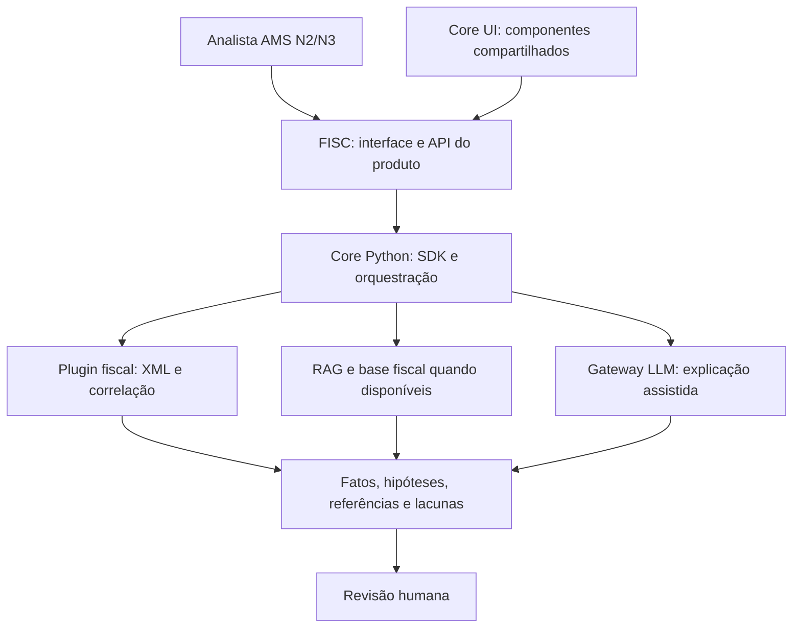

# FISC — Fiscal Incident Support Copilot

**Diagnóstico assistido de incidentes de NF-e, com fatos, hipóteses e evidências para revisão humana.**

O FISC apoia equipes **SAP AMS N2/N3** na investigação de incidentes de
**NF-e modelo 55, leiaute 4.00**. Combina verificações determinísticas de XML e
eventos, recuperação de referências fiscais e explicação assistida por IA
para organizar a investigação e orientar o próximo passo.

> **Maturidade:** MVP em construção, com avaliação baseada em casos sintéticos.
> Não há homologação fiscal ou validação operacional em SAP/SEFAZ reais.
> O produto analisa documentos e sistemas fiscais em modo read-only; a decisão
> e a execução de qualquer ação fiscal permanecem com pessoas autorizadas.

[Identidade e escopo](docs/IDENTIDADE_ESCOPO_FISC.md) ·
[Documentação técnica](docs/README.md) ·
[Código-fonte](src/dfe_copilot) ·
[Execução e configuração](docs/DEPLOY.md)

## Por que o FISC existe

Um timeout seguido de rejeição por duplicidade não explica, sozinho, a causa
do incidente. É preciso relacionar o retorno, a chave do documento e a linha
do tempo, verificar o XML e identificar quais informações ainda faltam.

O FISC organiza essa investigação e distingue o que foi observado do que é
hipótese. O benefício esperado é reduzir o esforço de triagem e tornar a
análise rastreável; ganhos de tempo e precisão em produção ainda precisam
ser medidos.

## O que você pode investigar

| Situação | Apoio oferecido |
|---|---|
| Duplicidade — `cStat 204` | Examina o retorno e a linha do tempo para avaliar a hipótese de reenvio após timeout do mesmo documento |
| Divergência de chave — `cStat 539` | Organiza achados conforme a regra de correlação implementada |
| Timeout sem retorno | Explicita o resultado desconhecido e as verificações necessárias antes de decidir por reenvio |
| Dúvidas sobre o XML recebido | Verifica parse, chave, protocolo, XSD quando aplicável e integridade XMLDSig no perfil suportado |
| Necessidade de fundamentação | Recupera referências da base fiscal quando disponível e apresenta fontes e lacunas |

Interpretar outros códigos de retorno não significa possuir diagnóstico
especializado para toda rejeição. Um XML válido no XSD também não comprova
validade tributária, autorização ou confiança da cadeia do certificado.

## Exemplo de investigação

**Cenário ilustrativo, sem execução neste README:** a operação informa que
uma NF-e sofreu timeout e retornou `cStat 204` após um novo envio.

1. O analista fornece a descrição, o XML de retorno disponível, o ambiente,
   a UF e os eventos relacionados explicitamente à mesma chave de acesso.
2. As ferramentas verificam o XML e extraem o retorno. A regra de correlação
   procura dois ou mais envios do mesmo documento com timeout entre eles.
3. O resultado distingue o **fato** de existir retorno 204 da **hipótese** de
   reenvio após timeout. Sem os eventos necessários, registra a lacuna em vez
   de afirmar essa causa.
4. O analista revisa as evidências e realiza a verificação autorizada da
   situação do documento antes de decidir por uma ação operacional.

O FISC não consulta a SEFAZ nem reenvia a NF-e automaticamente. Uma hipótese
produzida pelo LLM não confirma a causa.

Para o contrato de entrada e um exemplo de requisição, consulte o
[README técnico do produto](pyproject.toml). Os cenários de demonstração são sintéticos.

## Arquitetura resumida

O **FISC** possui domínio, interface e ponto de entrada próprios.
O **Integration Incident Copilot (IIC)** é o produto de diagnóstico de
integrações empresariais. Ambos reutilizam `copilot-core` e
`@copilot/core-ui`; um produto não importa o outro.

O compartilhamento preserva serviços de gateway LLM, RAG, evidências,
autenticação e infraestrutura. As regras e fontes fiscais permanecem no FISC.
Consulte os [contratos públicos do core](https://github.com/marcos-slima/copilot-platform/blob/core%2Fv1.5.0/packages/core/docs/CONTRACTS.md).

## Código e execução independentes

**Este repositório é a fonte oficial do código do FISC.** Backend, frontend,
testes, Docker e CI estão aqui. O core Python e a biblioteca UI continuam
compartilhados com o IIC e são consumidos por releases versionadas, sem copiar
suas fontes.

| Componente | Local |
|---|---|
| Backend fiscal | [src/dfe_copilot](src/dfe_copilot) |
| Interface | [frontend](frontend) |
| Testes fiscais | [tests](tests) |
| Execução e ambientes | [Guia de execução](docs/DEPLOY.md) |
| Bibliotecas e hashes | [shared-libraries.json](shared-libraries.json) |
| Histórico e corte de migração | [Registro de extração](docs/EXTRACAO_CODIGO.md) |

Os identificadores permanecem: distribuição Python dfe-copilot, módulo
dfe_copilot, plugin dfe e shell @copilot/dfe-ui.

## Como experimentar

Clone este repositório. Para Docker, copie .env.example para .env, configure
credenciais e modelos conforme o [guia de execução](docs/DEPLOY.md) e execute:

~~~bash
docker compose --env-file .env up -d --build
~~~

A UI fica por padrão em http://127.0.0.1:8002. O Compose cria Qdrant próprio;
Ollama e modelos são provisionados no host. O build usa somente este checkout
e releases públicas das bibliotecas compartilhadas. Não usa checkout do IIC.

Para desenvolvimento e testes, siga o guia: ele instala core e produto como
wheels e compila a UI antes de executar a aplicação.

## Maturidade e limites

| Aspecto | Situação |
|---|---|
| Domínio fiscal | NF-e 55, leiaute 4.00; regras especializadas de duplicidade, divergência de chave e timeout |
| UI, empacotamento e imagem | Implementados, com verificações locais históricas registradas |
| Testes e avaliação | Casos sintéticos; aceites locais não substituem validação fiscal externa |
| CI | Workflow próprio neste repositório; resultados por commit na aba Actions |
| Base fiscal e revisão persistente | Dependem dos serviços e da configuração do ambiente |
| Revisão especializada | Pendente conforme o registro de pendências |
| SAP/SEFAZ reais e homologação | Não comprovados pelos aceites citados |

O contrato aceita UFs e ambientes de homologação/produção, mas essa aceitação
não comprova cobertura normativa por UF nem prontidão operacional nesses
ambientes. A verificação de integridade XMLDSig não inclui confiança completa
ICP-Brasil, cadeia e revogação.

O limite read-only se aplica aos documentos e sistemas fiscais. Diagnósticos,
revisões humanas e dados operacionais podem ser persistidos conforme a
configuração.

Estão fora do escopo atual: suporte completo a NFC-e, NFS-e, CT-e e MDF-e;
cálculo tributário completo; consulta direta à SEFAZ; emissão, autorização,
retransmissão, cancelamento, inutilização e execução de contingência.

## Versionamento e entregas

FISC, IIC, core Python, core-ui e operações seguem versões independentes. Consulte a
[política de releases](docs/VERSIONAMENTO_RELEASES.md) e o
[índice de entregas do FISC](docs/RELEASES.md). A versão declarada no manifest
não comprova disponibilidade de pacote ou imagem publicados.

## Evidências de validação

Em 2026-11-16, um perfil externo passou em 214 testes fiscais em Python 3.12
e em 214 testes em Python 3.14, além de build da UI, wheel e smoke da imagem.
Foram usados artefatos compartilhados aprovados no CI, sem fontes ou ambiente
do core/IIC. Consulte [o registro histórico e seus limites](docs/history/VALIDACAO_FORA_MONOREPO.md).
A adoção posterior de core 1.4.1/core-ui 0.1.1/operações 1.0.0 está no
[guia de adoção](docs/ADOCAO_PLATAFORMA.md).
Isso não constitui publicação em registro ou homologação fiscal.

## Documentação e manutenção

Consulte o [mapa de fontes oficiais](docs/ORGANIZACAO_DOCUMENTACAO.md) e o
[guia de contribuição](CONTRIBUTING.md) para saber onde propor cada alteração.

| Preciso de… | Consulte |
|---|---|
| Posicionamento e fronteiras do produto | [Identidade e escopo](docs/IDENTIDADE_ESCOPO_FISC.md) |
| Orientação de uso e revisão | [Manual do usuário](docs/MANUAL_USUARIO_FISC.md) |
| Instalação, credenciais e serviços | [Guia de execução](docs/DEPLOY.md) |
| Arquitetura, processos e governança | [Índice documental](docs/README.md) |
| Contrato de entrada e requisição de exemplo | [README técnico](pyproject.toml) |
| Restrições e validações pendentes | [Pendências](docs/PENDENCIAS.md) |
| Evidência histórica de testes locais | [Aceite P2](docs/ACEITE_P2.md) e [aceite P6](docs/ACEITE_P6.md) |
| Licença da implementação | [Licença MIT](LICENSE) |

O código foi extraído preservando o histórico fiscal. As bibliotecas têm
releases próprias na Copilot Platform; novas releases do produto FISC usam este repositório.

Use as [issues deste repositório](https://github.com/marcos-slima/fiscal-incident-support-copilot/issues)
para dúvidas e problemas do FISC. Alterações de código do FISC são propostas neste repositório.
Ao relatar problemas, use dados sintéticos ou anonimizados e preserve o
contexto necessário para reproduzir o caso.

A base compartilhada agora pertence a [Copilot Platform](https://github.com/marcos-slima/copilot-platform).
Veja [a adoção e suas versões independentes](docs/ADOCAO_PLATAFORMA.md).

O [índice documental](docs/README.md) distingue guias atuais, decisões e histórico.
