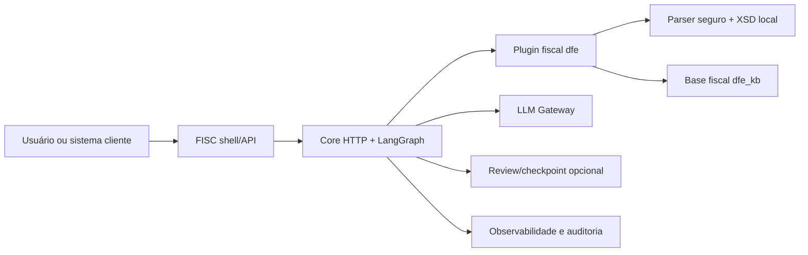

> Referência de desenho e governança importada do checkout versionado anterior.
> Não é novo aceite de capacidade ou validação externa. A estrutura executável
> atual está em [arquitetura](ARCHITECTURE.md). Requisitos e propostas devem
> ser distinguidos de implementação e evidência datada.

# Arquitetura de solução — FISC

## 1. Decisão central

O FISC é um produto especializado que depende de contratos neutros do core.
Core Python, core-ui e operações são publicados por Copilot Platform; não há
serviço remoto de plataforma obrigatório nem fontes compartilhadas dentro do FISC.
O core não conhece NF-e, UF, SEFAZ, NFS-e, CT-e ou MDF-e. O domínio fiscal entra
por plugin, schema de contexto e componentes de UI.



## 2. Interfaces de entrada

- UI web com sessão;
- REST síncrono e assíncrono;
- MCP Streamable HTTP;
- A2A JSON-RPC;
- CloudEvents HTTP;
- AMQP 1.0 opcional;
- `/health`, `/ready`, Agent Card e `/domain-plugins`.

Essas interfaces são compartilháveis com o IIC, mas cada produto tem API,
imagem, chaves, cookie, base e shell próprios.

## 3. Fronteiras

```text
FISC shell → @copilot/core-ui → Core HTTP/SDK
FISC plugin → contrato Plugin 1.1
IIC shell  → @copilot/core-ui → Core HTTP/SDK
```

É proibido importar código-fonte do IIC no FISC ou do FISC no IIC. A troca
ocorre somente por contratos versionados.

## 4. Deployment

O deployment recomendado é separado:

- IIC em sua imagem e porta;
- FISC em sua imagem e porta;
- cookies e segredos distintos;
- Qdrant, PostgreSQL, Redis e filas isolados ou explicitamente namespaced;
- pipelines CI próprios.

O `compose.review.yaml` do FISC adiciona PostgreSQL somente quando revisão
humana persistente for necessária. A execução padrão não presume banco ou Redis.

## 5. Acesso externo

No MVP, o FISC lê:

- XML fornecido pelo chamador;
- XSD local com manifesto e hash;
- base fiscal Qdrant quando habilitada;
- LLM conforme a política de soberania;
- GraphRAG opcional.

Não há envio automático para SEFAZ nem consulta de autorização fiscal. SAP,
Event Mesh e demais conectores do core são integrações genéricas e não provam
suporte tributário estadual.

## 6. Segurança e isolamento

- chaves dedicadas para REST, A2A, eventos e administração;
- sessão web assinada e `HttpOnly`;
- XML sem DTD, entidades externas ou resolução de rede;
- credenciais persistentes cifradas quando configuradas;
- política de soberania `strict` por padrão;
- MCP fail-closed por capability registry;
- limites de taxa e timeout;
- evidência com origem, locator, hash e trust level.

O isolamento multi-tenant é parcial no estado atual e não deve ser apresentado
como fronteira completa de autorização sem configuração e validação adicionais.

## 7. Evolução para outras famílias

NFS-e, CT-e e MDF-e devem entrar como plugins e pacotes próprios, por exemplo:

```text
fisc-nfe   → NF-e 55/65
fisc-nfse  → NFS-e e município/provedor
fisc-cte   → CT-e
fisc-mdfe  → MDF-e
```

Cada pacote precisa declarar schema, versão, jurisdição, vigência, fontes,
regras, limites e testes. Não se deve adicionar `if family == ...` ao core.
