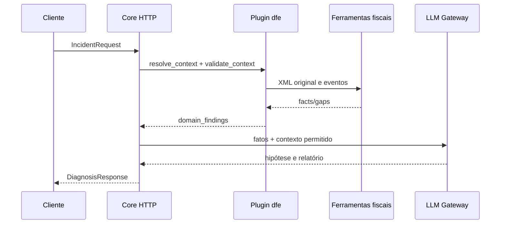

> Referência de desenho e governança importada do checkout versionado anterior.
> Não é novo aceite de capacidade ou validação externa. A estrutura executável
> atual está em [arquitetura](ARCHITECTURE.md). Requisitos e propostas devem
> ser distinguidos de implementação e evidência datada.

# Arquitetura de software — FISC

## 1. Componentes

| Componente | Responsabilidade | Contrato |
|---|---|---|
| `dfe_copilot.main` | Entrada da aplicação fiscal e UI | FastAPI/Core HTTP |
| `dfe_copilot.plugin` | Adaptador de domínio | Plugin 1.1 |
| `dfe_copilot.context` | `FiscalContext` | JSON Schema versionado |
| `fiscal.xml_tools` | Parser seguro, chave, XSD, protocolo | findings determinísticos |
| `fiscal.signature` | XMLDSig NF-e read-only | finding de assinatura |
| `fiscal.correlation` | Eventos e correlação | findings de timeout/duplicidade |
| `dfe_copilot.kb` | ingestão e busca fiscal | evidência `rule_reference` |
| `@copilot/dfe-ui` | Shell visual do produto | `@copilot/core-ui` |
| `@copilot/core-ui` | Componentes neutros | pacote UI 0.1.1 |

## 2. Fluxo de execução

## 3. Contratos públicos

- HTTP: versão 1.0 via `X-Core-Contract-Version`;
- Plugin: versão 1.1, com `contract_version`;
- SDK Python: versão 1.0;
- UI: pacote `@copilot/core-ui` versão 0.1.1;
- resposta: `DiagnosisResponse`, `Finding`, `Evidence` e `HumanReviewState`.

Mudanças aditivas opcionais podem elevar minor. Remoção, renomeação ou mudança
semântica exige major e migração explícita.

## 4. Modelo de evidência

O plugin produz fatos; o LLM produz hipóteses. O core valida referências,
`evidence_refs`, `source_id`, `locator` e `trust_level`. Score de recuperação
não vira confiança diagnóstica automaticamente.

## 5. Erros e degradação

- contexto inválido: HTTP 422;
- contrato incompatível: HTTP 409;
- credencial inválida: HTTP 401;
- dependência indisponível: HTTP 503 ou finding de lacuna, conforme o caminho;
- XML malformado: finding `G-xml`, sem chamada externa;
- base fiscal ausente: `G-kb`, sem inventar fonte;
- timeout: resposta controlada ou falha identificável.

## 6. Testes e gates

O software deve ser verificado em camadas:

1. testes unitários de parser, assinatura, contexto e correlação;
2. testes do plugin sem LLM nem rede;
3. testes do core sem instalar produtos;
4. build independente do shell FISC;
5. teste de imports proibidos;
6. smoke da imagem Docker;
7. validação da preservação da base Qdrant quando usada em modo existente;
8. exemplos de canais do checkout anterior não foram transferidos para este produto; seus testes não fazem parte da CI atual.

## 7. Limites conhecidos

- `FiscalContext` aceita apenas NF-e 55/4.00;
- regras tributárias completas por UF não estão implementadas;
- assinatura verifica integridade e perfil, não cadeia ICP-Brasil/LCR;
- integração real com SEFAZ não está implementada;
- persistência de revisão humana é opcional;
- isolamento por tenant requer configuração e revisão adicional;
- resultados contra LLM, broker ou SAP real não devem ser inferidos de testes
  offline.
