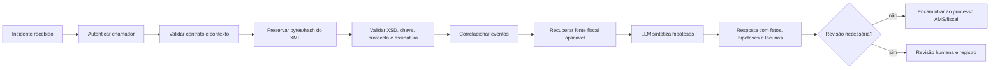

> Referência de desenho e governança importada do checkout versionado anterior.
> Não é novo aceite de capacidade ou validação externa. A estrutura executável
> atual está em [arquitetura](ARCHITECTURE.md). Requisitos e propostas devem
> ser distinguidos de implementação e evidência datada.

# Processos operacionais e de governança — FISC

## 1. Processo de diagnóstico

### Entradas aceitas

- UI do FISC;
- `POST /diagnose`;
- `POST /diagnose/async`;
- MCP `diagnose_incident`;
- A2A `message/send`;
- CloudEvents em `POST /events/incident`;
- AMQP 1.0 quando o consumidor estiver configurado.

## 2. Processo de triagem

O analista deve classificar o caso em:

1. **Documento disponível:** XML completo e chave identificável.
2. **Retorno disponível:** `protNFe`, `nfeProc` ou retorno de lote.
3. **Linha do tempo disponível:** envio, timeout e resposta correlacionados.
4. **Fonte normativa disponível:** trecho recuperado e aplicável ao modelo,
   versão, vigência e jurisdição.
5. **Ação externa necessária:** sempre fora da autonomia do FISC.

Se uma dessas condições faltar, o sistema deve registrar lacuna em vez de
preencher a informação por inferência.

## 3. Processo de revisão humana

1. O pipeline identifica escalonamento ou confiança insuficiente.
2. O estado fica `pending` e a resposta informa as ações permitidas.
3. O revisor confere fatos, fontes, versão do schema e contexto.
4. O revisor aprova, edita ou rejeita a hipótese.
5. O sistema retoma o checkpoint, quando persistência está habilitada.
6. A decisão operacional fiscal continua pertencendo ao time autorizado.

Não se deve interpretar `reviewed` como documento autorizado pela SEFAZ.

## 4. Processo de integração máquina-a-máquina

| Necessidade | Interface | Resultado |
|---|---|---|
| resposta imediata | REST síncrono | `DiagnosisResponse` |
| processamento longo | REST assíncrono | `job_id` + polling |
| agente com ferramentas | MCP | chamada de ferramenta read-only |
| agente para agente | A2A | task JSON-RPC |
| monitoramento push | CloudEvents | `202 Accepted` e processamento posterior |
| broker empresarial | AMQP | consumo e reentrega conforme broker |

Cada integração deve usar a chave correspondente, timeout explícito, retry
idempotente e correlação própria. Não se deve repetir cegamente um diagnóstico
que já tenha sido aceito por CloudEvents.

## 5. Processo de operação diária

### Início

- verificar `/health`;
- verificar `/ready`;
- confirmar que o plugin `dfe` aparece em `/domain-plugins`;
- conferir modelo, base `dfe_kb`, schema e ambiente;
- confirmar que as chaves não estão sendo impressas nos logs.

### Durante a operação

- acompanhar taxa de 401/403, 409, 422 e 503;
- acompanhar lacunas `G-kb`, `G-xml` e `G-events`;
- separar dados simulados de dados observados;
- não promover uma hipótese a causa confirmada sem revisão.

### Encerramento

- registrar decisão humana e referência do incidente;
- preservar o `incident_id`, evidências e versão do prompt;
- não remover o XML original da retenção aprovada;
- revisar se houve ação externa fora do FISC.

## 6. Processo de mudança

Qualquer alteração de contrato deve:

1. atualizar a decisão arquitetural correspondente;
2. atualizar o schema e o consumidor;
3. adicionar teste de compatibilidade;
4. executar o gate de fronteiras;
5. revisar documentação e exemplos;
6. registrar versão do contrato.

Regra fiscal nova exige fonte identificada, vigência, jurisdição, responsável
pela curadoria e casos positivos/negativos. O LLM não é fonte normativa.

## 7. Incidentes de segurança

Em suspeita de credencial exposta:

1. revogar/rotacionar a chave no ambiente;
2. preservar o `error_id` e os logs mínimos;
3. não copiar o segredo para tickets ou documentação;
4. avaliar exposição de XML e PII;
5. registrar o incidente no processo corporativo de segurança.

## 8. Catálogo BPMN e cartões Turbo EA

Os processos abaixo estão agrupados nos três arquivos BPMN editáveis em
`diagramas/bpmn/`. O cartão indicado é um identificador de trabalho; seu
cadastro real no Turbo EA ainda precisa ser executado.

| ID | Processo | Participantes/lanes | BPMN | Cartão |
|---|---|---|---|---|
| BP-01 | Solicitação manual | Analista / FISC | request + diagnosis | `FISC-BP-01` |
| BP-02 | REST síncrono | Sistema cliente / API FISC | request | `FISC-BP-02` |
| BP-03 | REST assíncrono | Sistema / API / worker | request | `FISC-BP-03` |
| BP-04 | MCP | Agente / MCP FISC | request | `FISC-BP-04` |
| BP-05 | A2A | Agente / A2A FISC | request | `FISC-BP-05` |
| BP-06 | CloudEvent | Monitor / webhook / worker | request | `FISC-BP-06` |
| BP-07 | AMQP | Broker / consumidor / FISC | request | `FISC-BP-07` |
| BP-08 | Triagem de evidências | Analista / ferramentas | diagnosis | `FISC-BP-08` |
| BP-09 | XML inválido | FISC / analista | diagnosis | `FISC-BP-09` |
| BP-10 | Diagnóstico com base fiscal | FISC / Qdrant / fonte | diagnosis | `FISC-BP-10` |
| BP-11 | Revisão humana | Revisor / checkpoint | diagnosis | `FISC-BP-11` |
| BP-12 | Escalonamento | Analista / especialista | diagnosis | `FISC-BP-12` |
| BP-13 | Encerramento | Analista / governança | diagnosis | `FISC-BP-13` |
| BP-14 | Indisponibilidade | Operação / dependência | governance | `FISC-BP-14` |
| BP-15 | Mudança de regra | Fiscal / engenharia / governança | governance | `FISC-BP-15` |
| BP-16 | Fontes e vigência | Curador fiscal / governança | governance | `FISC-BP-16` |
| BP-17 | Incidente de segurança | Security / operação / FISC | governance | `FISC-BP-17` |

Os pools representam organizações/sistemas; as lanes distinguem cliente,
FISC, operação e responsável fiscal. Os arquivos são modelos BPMN 2.0 sem
pretensão de provar execução operacional.
